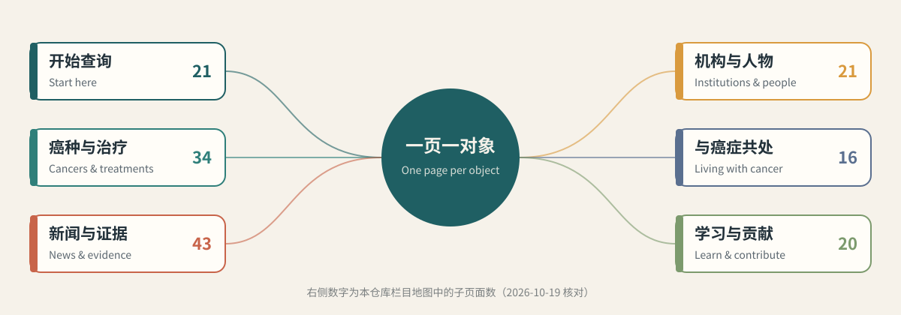

<p align="center">
  
</p>

<h1 align="center">OnCo Field Guide · OnCo肿瘤知识图谱导航</h1>

<p align="center">
  <strong>A large map of oncology, laid out as paths you can walk.</strong><br>
  把一张庞大的肿瘤学地图，整理成中文可走的路。
</p>

<p align="center">
  A bilingual guide to <a href="https://onco.cc/">onco.cc</a> for clinicians, researchers and medical educators: six sections, 155 pages, API access and attribution rules.
</p>

<p align="center">
  <a href="../README.md">简体中文</a> · <a href="英文说明v1.0.md">English</a>
</p>

<p align="center">
  <a href="https://github.com/TUANZIDING/onco-cc-guide/actions"></a>
  <a href="../LICENSE"></a>
  <a href="https://creativecommons.org/licenses/by-nc/4.0/"></a>
</p>

<p align="center">
  <code>Bilingual section map</code> · <code>Static JSON API</code> · <code>Runnable search example</code> · <code>Attribution rules</code>
</p>

<p align="center">
  <a href="#use-cases">Use cases</a> ｜ <a href="#showcase">Showcase</a> ｜ <a href="#quick-start">Quick start</a> ｜ <a href="#capabilities">Capabilities</a> ｜ <a href="#contribute">Contribute</a>
</p>

<p align="center"><sub>The hero image is an original SVG concept, not a screenshot of onco.cc. This is an independent guide, not affiliated with OnCo.</sub></p>

---

<a id="use-cases"></a>

## Start from your question · Use cases

[OnCo](https://onco.cc/) is a public, cited, editable knowledge graph of oncology: cancers, technologies, targets, treatments, companies, institutions, pathways, trials, roadmaps and ideas, one page each, with a plain-language TL;DR before the technical layer. This guide reorders its entry points around common questions.

| What you want | Where to start |
| --- | --- |
| Standard of care, history and pipeline for one cancer | [Cancers](https://onco.cc/cancers/), e.g. [TNBC](https://onco.cc/cancers/tnbc/); or [For me](https://onco.cc/for-me/) |
| Follow targets, drugs and trial readouts | [Targets](https://onco.cc/targets/) · [Treatments & tests](https://onco.cc/drugs/) · [Readout calendar](https://onco.cc/calendar/) |
| See a technology from past to horizon | [Roadmaps](https://onco.cc/roadmaps/), e.g. [ADC generations](https://onco.cc/roadmaps/adc-generations/), [Radiotherapy](https://onco.cc/roadmaps/radiation-roadmap/) |
| Radiation injury, muscle and bone recovery | [Radiation front](https://onco.cc/fronts/radiation/) · [Recovery & rejuvenation](https://onco.cc/fronts/rejuvenation/) · [Cachexia pathway](https://onco.cc/pathways/cachexia-biology/) |
| Find research gaps | [Bottlenecks](https://onco.cc/bottlenecks/) · [Ideas](https://onco.cc/ideas/) · [Open questions](https://onco.cc/open-questions/) |
| Analyse the data or connect AI tools | [Open API](https://onco.cc/api/) · this repo's [data access notes](数据接口v1.0.md) |

<p align="center">
  
</p>

<sub>Original SVG; numbers are pages listed in the section map (checked 2026-10-19) · [Full section map](栏目地图v1.0.md#english)</sub>

<a id="showcase"></a>

## The site at a glance · Showcase

Screenshots from the official OnCo repository (captured 2026-09-17), linked from its `docs/screenshots/`.

| Home | Body map |
| --- | --- |
| [](https://onco.cc/) | [](https://onco.cc/body/) |
| Graph explorer | Molecule gallery |
| [](https://onco.cc/graph/) | [](https://onco.cc/molecules/) |

<sub>Screenshots are copyright OnCo, linked rather than copied.</sub>

<a id="quick-start"></a>

## Quick start

**Browse:** open [onco.cc](https://onco.cc/) and use the [section map](栏目地图v1.0.md). The site has eight interface languages (the Aa button in the header).

**Use the data:** OnCo serves a key-free static JSON API. The example needs only Python 3:

```sh
git clone https://github.com/TUANZIDING/onco-cc-guide.git
cd onco-cc-guide
python3 示例/检索示例v1.0.py cachexia
```

It downloads `https://onco.cc/api/v1/search.json` (about 9 MB), lists matching objects with their page links, and prints OnCo's attribution line.

<a id="workflow"></a>

## Reading one object · Workflow

**TL;DR → technical layer and sources → linked objects → verify at the primary source**

| Need | How OnCo supports it |
| --- | --- |
| Know what something is, fast | One- or two-sentence plain TL;DR on every page |
| Find the evidence | Every record links at least one primary source with a last-checked date |
| See relationships | Cancers, drugs, targets, trials and papers link both ways |
| Read "approved" for your country | Pick a country in the header; approvals follow that regulator |

<a id="capabilities"></a>

## Capability status

| Status | Content | Limits |
| --- | --- | --- |
| Curated | Bilingual map of six sections and 155 pages | Follows the live site; onco.cc is authoritative |
| Checked | Map links, API paths and the example script resolve (2026-10-19) | Reachability only, not medical accuracy |
| Runnable | `示例/检索示例v1.0.py` keyword search | Needs network; data is OnCo's current build |
| External | Official CLI and MCP server | Build from `packages/` in the OnCo repo; the npm package named `onco` is unrelated |
| Not included | OnCo data copies, site source, medical advice | Get data from the official API or releases |

> OnCo states it is a work in progress and may be incomplete, out of date or wrong. It is not medical advice; verify at the primary source.

<a id="contribute"></a>

## Contribute

Better Chinese terms, reading paths by specialty or research line, and broken-link reports are welcome here. Errors in OnCo content go to the [OnCo repository](https://github.com/judegomila/OnCo/issues) or [Suggest an edit](https://onco.cc/suggest/).

| Looking for | Go to |
| --- | --- |
| All sections and links | [Section map](栏目地图v1.0.md) |
| API, CLI and MCP | [Data access](数据接口v1.0.md#mcp) |
| Sources and licences | [Sources](素材说明v1.0.md) |
| Local check | `python3 验证/项目检查v1.0.py` |
| Issues | [GitHub Issues](https://github.com/TUANZIDING/onco-cc-guide/issues) |

---

<p align="center">
  <strong>OnCo Field Guide · OnCo肿瘤知识图谱导航</strong><br>
  Start from a question, follow the links to the evidence.<br>
  <a href="https://github.com/TUANZIDING">TUANZIDING</a> · <a href="../LICENSE">MIT</a> · <a href="素材说明v1.0.md">Sources</a>
</p>

<sub>Original docs, SVGs and scripts here are MIT. OnCo data and text are copyright OnCo under CC BY-NC 4.0 for non-commercial individual and educational use, with the attribution "Data from OnCo (onco.cc)"; commercial use needs a licence from OnCo. OnCo code is MIT.</sub>
